## Projetos

| Projeto | Área | Tecnologias | Repositório |
| --- | --- | --- | --- |
| Estação meteorológica | Sensores e telemetria | Arduino, C++ | Privado |
| Monitoramento assistivo | IoT | ESP32 | Privado |
| Rastreador de localização | Hardware | ESP32 | Privado |
| Plataforma de logística local | Modelagem de sistemas | Requisitos e modelagem | Privado |
| Jogo de terminal | Estruturas de dados | C | Privado |
| Sites para comércio local | Web | HTML, CSS, JavaScript | Privado |
| Interface experimental para agentes | Web | HTML, CSS, JavaScript | Privado |
| [Bot para Telegram](https://github.com/caiobazzommelo-c/bot-telegram) | Automação | Python | Público |

A maior parte do que construo é pessoal ou acadêmico e fica em repositórios privados. Se algum projeto despertar interesse, é só conversar.

## Ferramentas

- **Linguagens:** C, C++, Python, JavaScript, HTML, CSS
- **Hardware:** Arduino, ESP32
- **Conhecimentos:** estruturas de dados, redes, segurança da informação, modelagem de sistemas
- **Fluxo de trabalho:** Git e GitHub

Fora do computador, jogo badminton em competições.
