## Projetos

Repositório público: [bot-telegram](https://github.com/caiobazzommelo-c/bot-telegram)

## Stack

Também: estruturas de dados, redes, segurança da informação e modelagem de sistemas.

Fora do computador, jogo badminton em competições.
